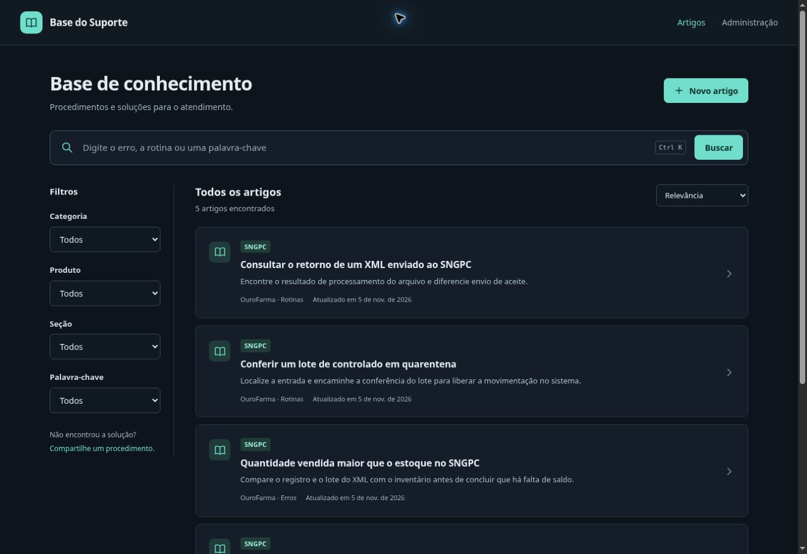

# Revisão da interface e da inicialização

A revisão mantém a identidade escura com destaque verde, concentra a primeira tela na busca e organiza o conteúdo para consulta durante o atendimento.

| Ponto revisado | Resultado |
| --- | --- |
| Logo desalinhada e símbolos dependentes da fonte | Ícone SVG consistente no cabeçalho e no favicon. |
| Abertura ocupando grande parte da tela | Cabeçalho compacto, busca e lista de artigos logo no início. |
| Muitos blocos e textos pequenos | Lista com título, resumo e metadados; tipografia maior e espaçamentos padronizados. |
| Filtros ocupando a tela do celular | Filtros recolhíveis, com indicação da quantidade aplicada. |
| Formulário com passos e imagens separados | Um único procedimento por seções, com os passos antigos preservados. |
| Campos avançados sempre expostos | Endereço e cuidados opcionais agrupados; avisos existentes continuam visíveis. |
| Artigo novo identificado como publicado | Estado “Não publicado” até concluir a gravação. |
| Cópia de link dependente de HTTPS | Alternativa compatível com HTTP e campo selecionável quando a cópia automática não está disponível. |
| Ações cobrindo campos no celular | Botões acompanham o fluxo do formulário nas telas pequenas. |
| Endereço inicial em localhost | Inicializador escuta em `0.0.0.0`, abre o IP da rede e gera `ENDERECO_DO_SITE.txt`. |
| Janela CMD necessária durante o uso | Supervisor oculto, logs e comandos independentes para iniciar e parar. |
| Risco de encerrar processo errado por PID antigo | Confere pasta, PID, executável e instante de criação; solicita encerramento por canal interno. |

## Verificação

- 18 testes da API/rede e 13 testes da interface.
- Build, lint e smoke da aplicação pronta.
- Windows: CMD fecha, servidor permanece ativo, HTTP responde pelo IP real da interface e repetir o comando não duplica a instância.
- Windows: download oficial do Node com verificação SHA-256, instalação do zero, caminho com espaços, reinício com cache, preservação de `.env`, parada com liberação da porta e recusa de PID com identidade divergente.
- Navegador: busca, cópia de link em HTTP, edição de artigo antigo, publicação com JPEG, legenda e associação ao passo.
- Navegador: lista, filtros e editor em larguras de celular e tablet. Nas verificações em 320, 390 e 768 px o documento não ultrapassou horizontalmente sua área disponível.

Os testes visuais usam uma instalação de desenvolvimento separada. O artigo temporário foi retirado da listagem da prévia depois da conferência. A instalação existente do usuário e seus dados não foram substituídos remotamente.

## Capturas da interface revisada

[Ver a interface no celular](interface-mobile-1793903833691.jpg).

## Usar a atualização

Encerre a instância anterior, faça uma cópia dos dados e atualize os arquivos preservando `.env` e `data/`. Execute `INICIAR_SITE.cmd`; a janela fecha e o navegador abre quando o servidor estiver pronto. Use `PARAR_SITE.cmd` para encerrar e `VER_LOGS.cmd` para diagnóstico.

A porta padrão é 1992. Outros computadores precisam alcançar o IP do servidor e ter a conexão permitida pelo firewall. O comando opcional `LIBERAR_REDE.cmd` solicita elevação para uma regra restrita à sub-rede local nos perfis Privado/Domínio. A configuração efetiva do firewall do computador do usuário não foi alterada nesta revisão.
